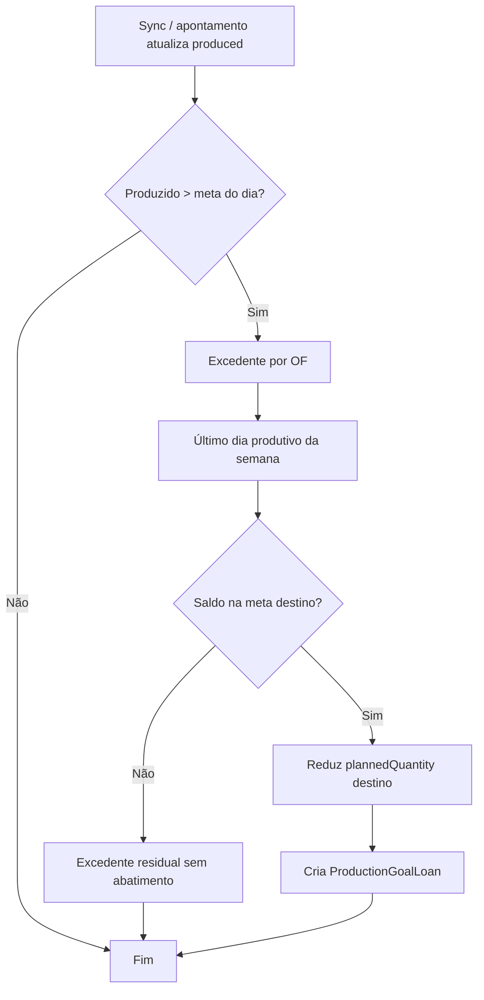

# PCP — PMP (Plano Mestre de Produção)

> **Status:** em estruturação — escopo inicial, models e regra de **antecipação de produção** definidos abaixo. Demais pontos (UI, sync, fontes) seguem em aberto.

## 1. Objetivo

O PMP é o segundo módulo da home do PCP, ao lado do **Controle Produtivo por bloco**.

Enquanto o Controle Produtivo acompanha a **execução** (OFs do dia, atrasadas e processos em andamento nas máquinas), o PMP cuida do **planejamento**: o que deve ser produzido, quanto e quando, por peça, centro de custo e operação — com metas **semanais** repartidas em **dias produtivos**.

---

## 2. Relação com o Controle Produtivo

| | PMP | Controle Produtivo por bloco |
|---|---|---|
| Horizonte | Semanas / meses | Dia atual e atrasos |
| Pergunta | O que vamos produzir? | O que está sendo produzido? |
| Unidade | Produto / meta diária / OF alocada | OF / máquina / linha |
| Origem dos dados | Planejamento mestre + sync execução | Consultas de planejamento e execução |

O PMP define e ajusta a **distribuição diária** das metas (inclusive antecipações). O Controle Produtivo mostra se o planejado do **bloco** está sendo cumprido no chão de fábrica. Os dois módulos compartilham conceitos (OF, centro de custo, operação), mas o PMP não substitui o mapa de máquinas nem o fluxo por bloco.

---

## 3. Na home e navegação

- A home exibe dois cards: **Controle Produtivo** e **PMP**, com link para `/controle-produtivo` e `/pmp`.
- Menu lateral: entrada **PMP** (`/pmp`).
- Tela inicial do módulo: lista de **blocos PMP** (`PmpBlocksPage`), no mesmo padrão de grid/cards do Controle Produtivo.
- Admin cria/edita bloco: nome, seleção de centros de custo (`GET /sectors`, campo `linkedPmpBlock`), operações por CC.

---

## 4. Conceitos do domínio

### 4.0 Hierarquia organizacional (PMP)

O PMP usa **blocos próprios** (`PmpBlock`), independentes do `Block` do **Controle Produtivo** (mapa / máquinas / OF do dia). No futuro pode haver vínculo ou espelhamento entre os dois; no banco são tabelas separadas.

```text
PmpBlock
└── PmpCostCenter (costCenter, sectorName, sectorIdApi)
    └── PmpCostCenterOperation (operation: número da OP)
        └── ProductionWeeklyGoal (por productCode + semana)
            └── ProductionDailyGoal (por dia produtivo)
                ├── ProductionDailyGoalOrder (OF externa)
                └── ProductionGoalLoan (antecipação)
```

| Entidade | Papel |
|---|---|
| `PmpBlock` | Agrupa planejamento; um bloco PMP possui **vários** centros de custo e **várias** `ProductionWeeklyGoal`. |
| `PmpCostCenter` | CC cadastrado no bloco; `sectorIdApi` = identificador do setor na **API externa** (consulta de planejamento / processos). |
| `PmpCostCenterOperation` | Cada CC pode ter **várias operações** (número da OP). Metas e antecipação respeitam **CC + operação**. |

**Unicidade**

- CC no bloco: `(pmpBlockId, costCenter)` e `(pmpBlockId, sectorIdApi)`.
- Operação no CC: `(pmpCostCenterId, operation)`.
- Meta semanal: `(pmpBlockId, productCode, pmpCostCenterOperationId, weekStart)`.

### 4.1 Meta semanal (`ProductionWeeklyGoal`)

- Pertence a um **`PmpBlock`** e a um **`PmpCostCenterOperation`** (define CC + operação).
- Agrupa o planejamento de uma **peça** (`productCode`) em uma **semana** (`weekStart` / `weekEnd`).
- `plannedQuantity`: meta semanal **original** (não muda por antecipação).
- `producedQuantity`: acumulado realizado na semana (atualizado conforme sync / apontamentos).
- `dailyGoals`: fatia da meta por dia produtivo.

### 4.2 Meta diária (`ProductionDailyGoal`)

- Distribuição da meta semanal em um **dia produtivo** (`date`).
- `plannedQuantity`: meta **do dia** (pode ser **reduzida** por antecipação vinda de dias anteriores da mesma semana).
- `producedQuantity`: realizado naquele dia.
- `orders`: vínculo com OFs externas e quantidade alocada / produzida por OF naquele dia.

### 4.3 OF alocada ao dia (`ProductionDailyGoalOrder`)

- Relaciona uma meta diária a uma OF do sistema externo (`externalOrderId`) e à **operação**.
- `allocatedQuantity`: quanto da meta daquele dia está alocado à OF.
- `producedQuantity`: quanto essa OF já contribuiu no dia (base para detectar excedente).

### 4.4 Empréstimo de meta — antecipação (`ProductionGoalLoan`)

- Registro **imutável de histórico** de cada abatimento: dia/fonte → último dia produtivo da semana/destino, por OF.
- Um registro **por OF** quando houver excedente (regra 5).
- Base para idempotência na sync (regra 6): não reaplicar o mesmo excedente.

---

## 5. Regra de negócio — Antecipação de produção

### 5.1 Objetivo

Quando a produção de um **dia** ultrapassa a **meta diária**, o **excedente** abate automaticamente a meta do **último dia produtivo** da **mesma semana**, **mesma peça**, **mesmo centro de custo** e **mesma operação**, mantendo a meta semanal original e o histórico da movimentação.

### 5.2 Funcionamento

1. Cada peça possui meta semanal, distribuída em dias produtivos via `ProductionDailyGoal`.
2. Após atualizar `producedQuantity` (sync com banco externo ou apontamento interno), se  
   `producedQuantity > plannedQuantity` **no dia fonte** (considerando alocação por OF), calcula-se o **excedente** por OF.
3. Para cada OF com excedente, localiza-se o `ProductionDailyGoal` do **último dia produtivo** da semana (mesmo eixo peça / CC / operação).
4. Reduz `plannedQuantity` do dia **destino** em até `min(excedente, saldo disponível na meta de destino)`.
5. Grava `ProductionGoalLoan` na mesma transação.

**Exemplo**

| | Valor |
|---|---|
| Meta terça | 8 pç |
| Produzido terça | 10 pç |
| Excedente | 2 pç |
| Meta original sexta | 10 pç |
| Nova meta sexta | 8 pç |

O sistema registra que **2 pç** foram antecipadas na terça, com a **OF** responsável pelo excedente.

### 5.3 Regras

1. Antecipação **somente** se produção do dia **ultrapassar** a meta diária estabelecida.
2. Abatimento **somente** na meta do **último dia produtivo** da mesma semana, mesma peça, **mesmo bloco PMP**, **mesma operação** (`PmpCostCenterOperation`) — portanto mesmo centro de custo e número de operação.
3. Toda antecipação gera registro em `ProductionGoalLoan`.
4. O histórico deve permitir identificar: quantidade, OF de origem, dia da antecipação e dia que recebeu o abatimento.
5. Excedentes de **OFs diferentes** → **um** `ProductionGoalLoan` **por OF**.
6. **Idempotência na sync:** o mesmo excedente não pode ser contabilizado ou abatido mais de uma vez (chave lógica sugerida: `(sourceDailyGoalId, sourceOrderId, borrowedQuantity)` ou controle de “lote de sync” + estado já processado; detalhar na implementação).
7. `ProductionWeeklyGoal.plannedQuantity` **não muda**; só a **distribuição diária** (`ProductionDailyGoal.plannedQuantity`).
8. Abatimento limitado ao **saldo** da meta de destino (`plannedQuantity` do último dia menos o que já foi emprestado). Excedente maior que o saldo **permanece sem abatimento** até outra regra tratar.
9. Ajuste de metas diárias + criação de `ProductionGoalLoan` na **mesma transação** de banco.

### 5.4 Resultado esperado

- PMP acompanha produções antecipadas e reflete na **programação diária** sem alterar o **total semanal** planejado.
- Rastreabilidade: quais OFs adiantaram produção e quais dias tiveram meta reduzida.

### 5.5 Fluxo lógico (referência para implementação)



---

## 6. Models Prisma

> Implementado em `backend/prisma/schema.prisma` (migration `20261110100000_pmp_domain`).

```prisma
model PmpBlock {
  id        String   @id @default(uuid())
  name      String   @unique
  createdAt DateTime @default(now())
  updatedAt DateTime @updatedAt

  costCenters PmpCostCenter[]
  weeklyGoals ProductionWeeklyGoal[]

  @@map("pmp_blocks")
}

model PmpCostCenter {
  id          String  @id @default(uuid())
  pmpBlockId  String
  costCenter  String
  sectorName  String?
  sectorIdApi String  @map("sector_id_api")

  pmpBlock   PmpBlock                 @relation(...)
  operations PmpCostCenterOperation[]

  @@unique([pmpBlockId, costCenter])
  @@unique([pmpBlockId, sectorIdApi])
  @@map("pmp_cost_centers")
}

model PmpCostCenterOperation {
  id              String @id @default(uuid())
  pmpCostCenterId String
  operation       Int

  pmpCostCenter PmpCostCenter          @relation(...)
  weeklyGoals   ProductionWeeklyGoal[]

  @@unique([pmpCostCenterId, operation])
  @@map("pmp_cost_center_operations")
}

model ProductionWeeklyGoal {
  id                       String   @id @default(uuid())
  pmpBlockId               String
  pmpCostCenterOperationId String

  productCode      String
  productName      String?

  weekStart        DateTime @db.Date
  weekEnd          DateTime @db.Date

  plannedQuantity  Int
  producedQuantity Int      @default(0)

  pmpBlock               PmpBlock
  pmpCostCenterOperation PmpCostCenterOperation
  dailyGoals             ProductionDailyGoal[]

  createdAt        DateTime @default(now())
  updatedAt        DateTime @updatedAt

  @@unique([pmpBlockId, productCode, pmpCostCenterOperationId, weekStart])
  @@map("production_weekly_goals")
}

model ProductionDailyGoal {
  id               String   @id @default(uuid())

  weeklyGoalId     String
  weeklyGoal       ProductionWeeklyGoal @relation(
    fields: [weeklyGoalId],
    references: [id],
    onDelete: Cascade
  )

  date             DateTime @db.Date
  plannedQuantity  Int
  producedQuantity Int      @default(0)

  orders           ProductionDailyGoalOrder[]

  loansGiven       ProductionGoalLoan[] @relation("LoanSource")
  loansReceived    ProductionGoalLoan[] @relation("LoanTarget")

  createdAt        DateTime @default(now())
  updatedAt        DateTime @updatedAt

  @@unique([weeklyGoalId, date])
  @@index([date])
}

model ProductionDailyGoalOrder {
  id                String @id @default(uuid())

  dailyGoalId       String
  dailyGoal         ProductionDailyGoal @relation(
    fields: [dailyGoalId],
    references: [id],
    onDelete: Cascade
  )

  externalOrderId   String
  operation         Int

  allocatedQuantity Int
  producedQuantity  Int @default(0)

  createdAt         DateTime @default(now())
  updatedAt         DateTime @updatedAt

  @@unique([dailyGoalId, externalOrderId, operation])
  @@index([externalOrderId, operation])
}

model ProductionGoalLoan {
  id                String   @id @default(uuid())

  sourceDailyGoalId String
  sourceDailyGoal   ProductionDailyGoal @relation(
    "LoanSource",
    fields: [sourceDailyGoalId],
    references: [id],
    onDelete: Restrict
  )

  targetDailyGoalId String
  targetDailyGoal   ProductionDailyGoal @relation(
    "LoanTarget",
    fields: [targetDailyGoalId],
    references: [id],
    onDelete: Restrict
  )

  sourceOrderId     String
  borrowedQuantity  Int

  createdAt         DateTime @default(now())

  @@index([sourceDailyGoalId])
  @@index([targetDailyGoalId])
  @@index([sourceOrderId])
}
```

**Notas de modelagem**

- `PmpBlock` ≠ `Block` (Controle Produtivo): nomes e IDs distintos; evita acoplamento prematuro com mapa de máquinas.
- `sectorIdApi` em `PmpCostCenter` é o ID de setor na API (equivalente conceitual ao `sectorIdBaseApi` do módulo de blocos de execução).
- CC + operação vêm de `PmpCostCenterOperation`; `operation` em `ProductionDailyGoalOrder` repete o número da OP para chave com `externalOrderId` na sync.
- `externalOrderId` identifica a OF na origem externa (não necessariamente o UUID de `ProductionOrder` do Controle Produtivo).
- `onDelete: Restrict` em `ProductionWeeklyGoal` → operação e em `ProductionGoalLoan` → metas diárias preservam histórico.

---

## 7. Escopo técnico inicial (próximos passos)

| Prioridade | Item |
|---|---|
| P0 | ~~Migration Prisma (bloco PMP, CC, operações, metas, empréstimos)~~ — feito em `20261110100000_pmp_domain` |
| P0 | CRUD de `PmpBlock` + CC + operações (API admin PMP) |
| P0 | Serviço `ProductionAnticipationService` (regras §5, transação única) |
| P0 | Definição de **último dia produtivo** (calendário: feriados, sábado, configuração por CC?) |
| P1 | Endpoint de consulta: metas semana/dia + lista de `ProductionGoalLoan` |
| P1 | Job ou hook pós-sync que recalcula excedente sem duplicar empréstimos |
| P2 | Telas PMP: visão semanal, drill-down diário, histórico de antecipações |
| P2 | Indicadores: planejado × realizado; meta destino após empréstimos |

---

## 8. Pontos ainda em aberto

- [ ] Fonte da demanda que **alimenta** `ProductionWeeklyGoal` (planilha, API, MRP interno).
- [ ] Como criar / revisar a distribuição inicial entre dias produtivos.
- [ ] Relação explícita entre `externalOrderId` e `ProductionOrder` do Controle Produtivo.
- [ ] Tratamento do excedente **sem saldo** no último dia (fila, próxima semana, alerta).
- [ ] Perfis de acesso (quem edita meta semanal vs quem só consulta antecipações).
- [ ] Testes de integração: sync repetida, concorrência, rollback de transação.

---

## 9. Referência rápida — diferença meta semanal × diária após antecipação

```text
Semana (plannedQuantity = 100)  ← inalterada
├── Seg  planned 20
├── Ter  planned 20  produced 22  → empréstimo 2 pç
├── Qua  planned 20
├── Qui  planned 20
└── Sex  planned 20  → após antecipação: planned 18
         ↑ último dia produtivo recebe o abatimento
```
